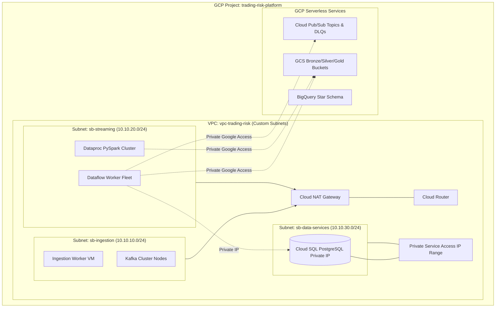

# Trading Risk Engine: Architecture & Systems Specification

## 1. Executive Summary

The **Trading Risk Engine** provides an ultra-low latency, horizontally scalable data processing fabric capable of tracking financial market risks across global portfolios. Modern regulatory mandates (Basel III / IV, Dodd-Frank, MiFID II) require sub-second detection of counterparty exposure overruns, market volatility breaches, and instantaneous calculation of portfolio Value-at-Risk (VaR).

This platform leverages Google Cloud Platform's serverless and managed data analytics stack, adhering strictly to enterprise security, zero-trust network design, and the Google Cloud Well-Architected Framework.

---

## 2. Infrastructure Architecture & Network Topology

### 2.1 Network Segmentation Principles
- **VPC Configuration**: Custom mode VPC `vpc-trading-risk`. Automatic subnet creation is disabled to prevent overlapping address spaces.
- **Private Google Access (PGA)**: Enabled across all subnets (`sb-ingestion`, `sb-streaming`, `sb-data-services`) allowing VMs and Dataflow/Dataproc workers to reach GCP APIs (Pub/Sub, BigQuery, GCS, Cloud Logging) securely over Google's internal backbone without public IP allocations.
- **Cloud NAT & Cloud Router**: Provides outbound-only internet connectivity for dependency installation and security updates, with zero ingress from the public internet.
- **Private Service Connect / Private Services Access (PSA)**: Allocates an internal CIDR reservation (`10.10.100.0/20`) peered with Google Services VPC to host Cloud SQL PostgreSQL strictly over private RFC 1918 addresses.
- **Strict Firewall Rules**:
  - `allow-internal`: Allows communication only between trusted internal tiers (e.g. Ingestion to Streaming, Streaming to Cloud SQL on port 5432).
  - `deny-all-ingress`: Default deny on public perimeter.
  - `allow-iap-ssh`: Restricts SSH access strictly to Google Identity-Aware Proxy (IAP) CIDR (`35.235.240.0/20`).

---

## 3. Data Flow & Processing Lifecycle

### 3.1 Tier 1: Real-Time Market Tick Ingestion (Kafka + PySpark)
1. Ingestion workers connect to tick feeds and push multi-asset records (`ticker`, `bid`, `ask`, `last_price`, `volume`, `timestamp`) into Apache Kafka partitioned by asset class and ticker.
2. Dataproc PySpark Structured Streaming consumes from Kafka, computing 60-second micro-batch VWAP and rolling standard deviation volatility bands.
3. Sink: PySpark streams partition-pruned, Snappy-compressed Parquet files into Cloud Storage (`gs://<bucket>-data-lake/bronze/ticks/year=YYYY/month=MM/day=DD/`).

### 3.2 Tier 2: Real-Time Order Stream & Anomaly Detection (Pub/Sub + Beam)
1. Order Execution Gateway publishes trade executions into Cloud Pub/Sub (`projects/<project>/topics/top-trade-orders`).
2. Cloud Dataflow (Apache Beam) pipeline consumes using Pub/Sub IO:
   - JSON validation and deserialization. Dead-letter publishing for schema violations.
   - 5-minute sliding window transform calculating sudden drawdown drop thresholds per portfolio.
   - Side-output / Multi-output routing: High-severity risk anomalies are routed directly to Cloud SQL PostgreSQL (`hot_risk_alerts` table), while all validated transactions are routed to GCS cold storage.

### 3.3 Tier 3: Batch Analytical Lakehouse (Composer + Databricks + BigQuery)
1. Cloud Composer (Airflow) DAG triggers daily batch pipelines.
2. Databricks Medallion processing:
   - **Silver**: Deduplication, reconciliation between executed orders and market tick prints, and corporate action adjustments.
   - **Gold**: Parametric and Monte Carlo Value-at-Risk (VaR) matrices at 95% and 99% confidence intervals across asset books.
3. BigQuery Star Schema:
   - Partitioned by event date, clustered by `portfolio_id` and `ticker`.
   - dbt Core transformations generating real-time analytics models and materialized views for financial risk reporting.
