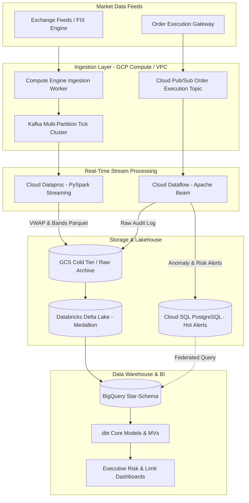

# Trading Risk Engine: Real-Time Multi-Asset Streaming & Risk Platform

[]()
[]()
[]()

## 1. System Overview

`trading-risk-engine` is an enterprise-grade, high-throughput financial streaming and real-time risk calculation platform hosted on Google Cloud Platform (GCP). It is engineered to process hundreds of thousands of multi-asset ticks per second (Equities, FX, Fixed Income, Derivatives), detecting risk breaches (e.g., sudden drawdowns, volatility spikes, exposure limit overruns) with sub-second latency while streaming clean analytics into BigQuery, Cloud SQL, and Delta Lake Bronze/Silver/Gold storage tiers.



---

## 2. Platform Architecture Layers

### 2.1 Ingestion Layer (`ingestion/`)
- Dedicated high-performance Compute Engine instance in secure private subnets.
- Systemd-managed Docker runtime hosting Kafka multi-partition tick brokers and async publishers.
- Pub/Sub topics equipped with dead-letter topics and retry exponential backoffs for order executions.

### 2.2 Streaming & Processing Layer (`streaming/`)
- **Cloud Dataflow (Apache Beam)**: Event-time sliding windows (5-minute rolling drop detectors), sessionization, custom DoFn anomaly detectors, and split outputs (Cloud SQL alerts vs. GCS raw archive).
- **Cloud Dataproc (PySpark Structured Streaming)**: Micro-batch stream processing calculating rolling VWAP (Volume-Weighted Average Price), Bollinger-style volatility bands, and Snappy-compressed partitioned Parquet outputs.

### 2.3 Lakehouse & Orchestration (`batch/`)
- **Cloud Composer (Apache Airflow)**: Production DAGs handling ephemeral Dataproc cluster creation/teardown, Databricks Delta Lake pipeline triggers, and Great Expectations data quality gates.
- **Databricks Medallion Architecture**:
  - **Bronze**: Raw tick and order ingestion with raw schema tracking.
  - **Silver**: Cleansed, deduplicated, schema-enforced records with watermarking.
  - **Gold**: Portfolio Value-at-Risk (VaR: Parametric and Historical), Monte Carlo simulations, and risk feature store.

### 2.4 Data Warehouse & Serving (`dwh/`)
- **BigQuery**: Partitioned (by date) and clustered (by ticker, asset_class) star schemas for tick-level and order-level data.
- **dbt**: Staging (`stg_`), Intermediate (`int_`), and Mart (`fct_`, `dim_`) models with materialized views for fast executive risk reporting.
- **External Federated Queries**: Hybrid joins between operational Cloud SQL limit tables and BigQuery analytics tables.

### 2.5 Infrastructure as Code (`terraform/`)
- Enterprise multi-subnet VPC architecture with Cloud NAT, private Google access, strict firewall rules, and zero public IP exposure for compute nodes.
- Modular Terraform layout: `network`, `storage`, `pubsub`, `cloudsql`, and `iam`.

---

## 3. Directory Layout

```
trading-risk-engine/
├── terraform/          # Infrastructure as Code (GCS, Pub/Sub, Cloud SQL, IAM, VPC)
│   ├── modules/
│   │   └── network/    # VPC, subnets, Cloud NAT, Cloud Router, firewall rules
│   ├── environments/   # Environment definitions (dev, prod)
│   └── main.tf         # Root Terraform entrypoint
├── ingestion/          # Compute Engine producers, Kafka brokers & Pub/Sub clients
├── streaming/          # Apache Beam (Dataflow) pipelines & PySpark (Dataproc) jobs
├── batch/              # Databricks Medallion notebooks & Cloud Composer (Airflow) DAGs
├── dwh/                # BigQuery schemas, DDL, partitioned tables, and dbt models
├── tests/              # Pytest suites, Beam TestStream, schema validations
├── .github/workflows/  # CI/CD pipelines and linting
├── ARCHITECTURE.md     # In-depth architectural design specifications
└── STATE.md            # Daily milestone tracking and runbook
```

---

## 4. Getting Started

### Prerequisites
- Google Cloud SDK (`gcloud` CLI)
- Terraform `>= 1.5.0`
- Python `>= 3.10`
- Docker & Docker Compose

### Local Testing
```bash
python -m pytest tests/ -v
```
