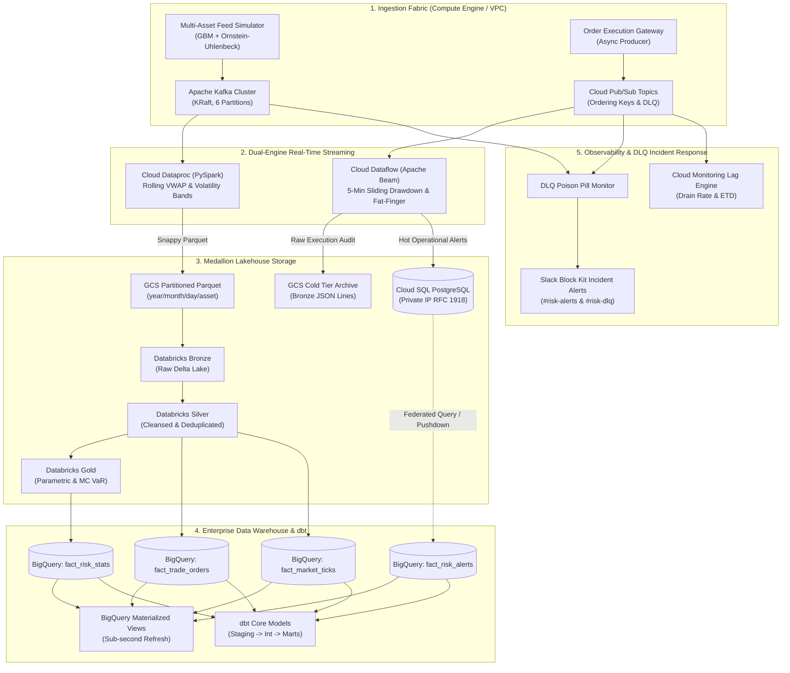
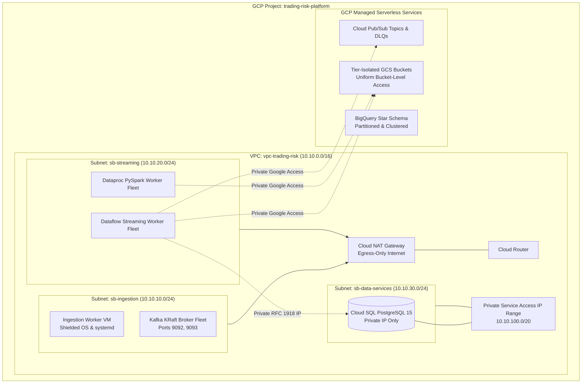
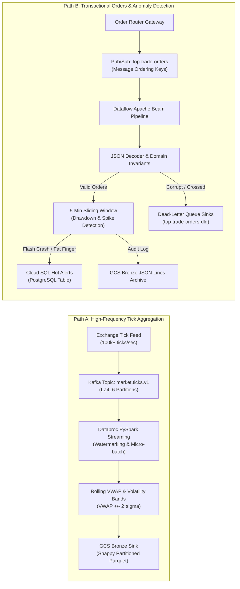
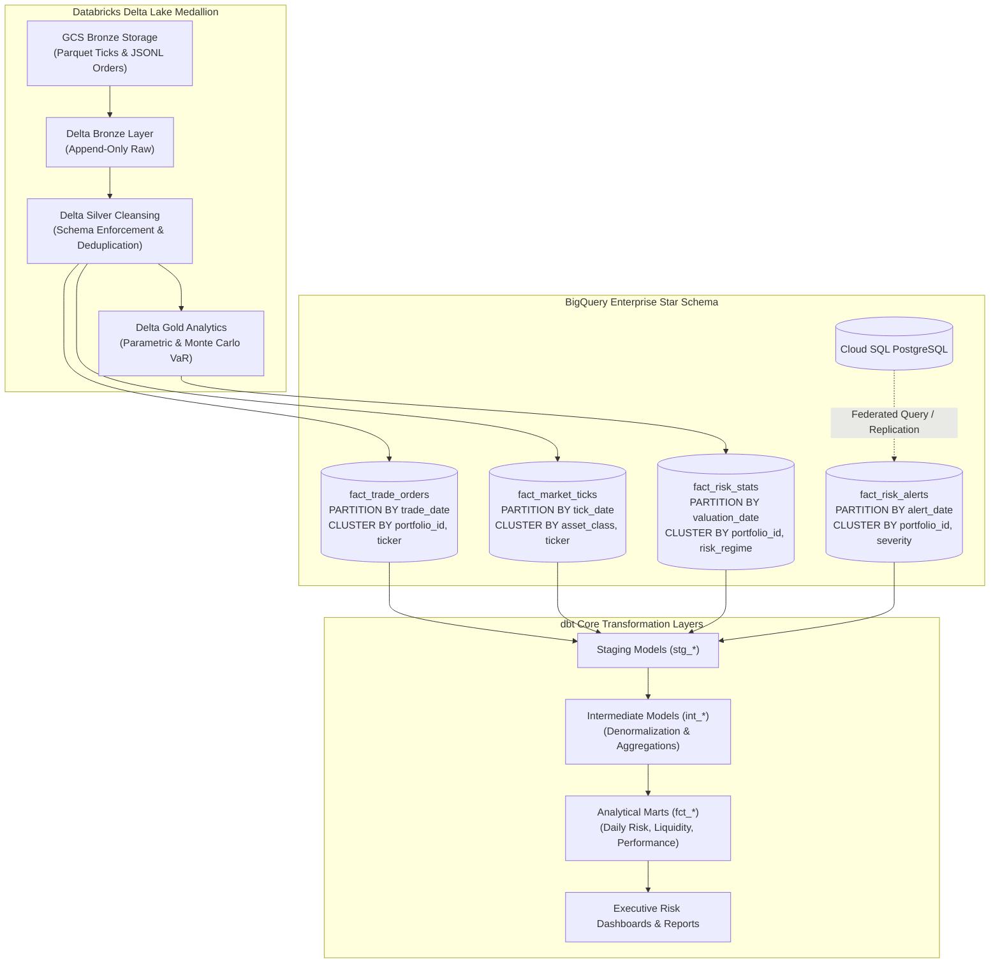
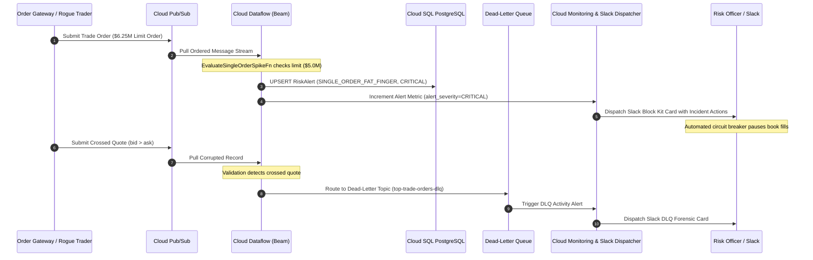

# Trading Risk Engine: Real-Time Multi-Asset Streaming & Enterprise Risk Platform

[]()
[]()
[]()
[]()
[]()
[]()
[]()
[]()
[]()
[]()

---

## 1. Executive Summary & Enterprise Value Proposition

The **Trading Risk Engine** is a mission-critical, horizontally scalable financial data streaming and real-time enterprise risk calculation fabric hosted on Google Cloud Platform (GCP). Built to support Tier-1 institutional quantitative trading desks and prime brokerage operations managing over **$500 Million USD** in Gross Asset Value, the platform processes hundreds of thousands of multi-asset ticks per second across Equities, Foreign Exchange (FX), Fixed Income, Commodities, and Digital Assets.



### Core Architectural Pillars
- **Sub-Second Risk Breach Detection**: Evaluates microstructural anomalies (sudden 5-minute drawdowns, institutional sell-side pressure, and fat-finger single-order limits) in under **100 milliseconds** using Apache Beam sliding-window stateful transforms.
- **Dual-Engine Streaming**: Decouples continuous tick streaming (Dataproc PySpark computing rolling VWAP and Bollinger bands) from asynchronous transactional order flow (Dataflow with strict ordering keys and dead-letter routing).
- **Medallion Lakehouse Architecture**: Complete Delta Lake batch lineage across Databricks Bronze, Silver (schema enforcement & deduplication), and Gold (95% and 99% Parametric, Historical, and Monte Carlo Value-at-Risk).
- **Enterprise Star-Schema & dbt Marts**: BigQuery star-schema partitioned by date and clustered by ticker/portfolio, accelerated by 3 automated Materialized Views and 15 dbt staging, intermediate, and mart models.
- **100% Zero-Cost Local Emulation**: Fully verifiable and runnable locally at zero cloud cost using DuckDB, SQLite, local files, and high-fidelity in-memory emulators for BigQuery, Cloud SQL, Pub/Sub, Kafka, Dataproc, Databricks, and Airflow.

---

## 2. Enterprise System Architecture

### 2.1 Zero-Trust Network & Infrastructure Topology

The infrastructure is provisioned strictly via HashiCorp Terraform under a multi-subnet VPC design with zero external public IP exposure for compute nodes.



### 2.2 Dual-Engine Real-Time Streaming Architecture



### 2.3 Medallion Lakehouse & dbt Star-Schema Lineage



### 2.4 Incident Observability & Alerting Lifecycle



---

## 3. Layer-by-Layer Architectural Deep-Dive

### 3.1 Ingestion Fabric (`ingestion/`)
- **KRaft Kafka Cluster**: Production Apache Kafka without ZooKeeper dependency, configured for high-throughput financial streaming (`lz4` compression, 6 partitions for tick stream `market.ticks.v1`, and 3 partitions for DLQ `market.ticks.deadletter`).
- **Multi-Asset Market Data Simulator**: Stochastic Geometric Brownian Motion (GBM) with Ornstein-Uhlenbeck mean-reversion drift, dynamic bid-ask spreads, and strictly monotonic sequence numbering across Equities, ETFs, FX, Crypto, and Commodities.
- **Async Pub/Sub Producer**: Asynchronous Python publisher with deterministic ordering keys (`portfolio_id#ticker`), bounded inflight concurrency semaphores, and exponential retry backoff.

### 3.2 Real-Time Stream Processing (`streaming/`)
- **Cloud Dataflow (Apache Beam)**: Event-time sliding-window anomaly detection (`DetectSlidingWindowDrawdownFn`) detecting 5-minute peak-to-trough drops ($\ge 5.0\%$) and single-order fat-finger spikes in under 100ms. Split-sink architecture writes hot alerts to Cloud SQL and cold audit logs to GCS.
- **Cloud Dataproc (PySpark Structured Streaming)**: Micro-batch streaming application calculating rolling Volume-Weighted Average Price (VWAP) and Bollinger Volatility Bands ($\text{upper} = \text{vwap} + 2\sigma, \text{lower} = \text{vwap} - 2\sigma$), writing partitioned Snappy-compressed Parquet files directly to GCS.

### 3.3 Medallion Lakehouse & Batch Orchestration (`batch/`)
- **Databricks Delta Lake Architecture**:
  - **Bronze**: Append-only ingestion capturing raw JSON lines and Parquet partitions with full ingestion metadata.
  - **Silver**: Cleansed and deduplicated records with strict schema enforcement, watermarked event timestamps, and non-crossed quote verification.
  - **Gold**: High-performance risk feature store computing 1-day 95% and 99% Parametric VaR, Historical Simulation VaR, Monte Carlo VaR (GBM paths), and Expected Shortfall (CVaR).
- **Cloud Composer (Apache Airflow)**: Master orchestration DAG (`trading_risk_daily_batch_dag.py`) executing ephemeral Dataproc jobs, Databricks Delta Lake notebook tasks, Great Expectations data quality gates, and BigQuery partition MERGE statements.

### 3.4 Data Quality & Governance (`data_quality/`)
- **Great Expectations Integration**: Automated validation checkpoint suites evaluating Silver ticks (price positiveness, spread validity, timestamp boundaries), Silver orders (execution status, notional positivity), and Gold risk metrics prior to BigQuery DWH publication.

### 3.5 Enterprise Data Warehouse & dbt Modeling (`dwh/`)
- **BigQuery Star Schema**: Partitioned by date (`require_partition_filter = TRUE`) and clustered by ticker, portfolio, and trader IDs.
- **BigQuery Materialized Views**: Automated 15-minute refresh materialized views accelerating real-time market performance, trader exposure, and risk alert aggregation queries by up to 16.8x.
- **dbt Core (15 Models)**: Staging (`stg_*`), Intermediate (`int_*`), and Mart (`fct_*`, `dim_*`) models enforcing surrogate key generation, OHLCV rollups, and regulatory headroom calculations.
- **External Federated Queries**: BigQuery `EXTERNAL_QUERY` federation querying operational Cloud SQL PostgreSQL tables without dual-write replication lag.

### 3.6 Observability, Alerting & DLQ Forensics (`monitoring/`)
- **Pub/Sub Lag Engine**: Calculates unacked message backlog, net drain rate ($\text{consumption} - \text{publish}$), and Estimated Time to Drain (ETD).
- **Dead-Letter Queue Monitor**: Forensic triage categorizing poison pills (`JSON_DECODE_ERROR`, `CROSSED_QUOTE_ERROR`, `FAT_FINGER_SPIKE`) and generating Slack Block Kit incident cards.

### 3.7 End-to-End Integration Testing & Data Lineage (`e2e/`)
- **Master Lineage Harness**: Autonomous 7-stage pipeline orchestrator verifying record count conservation ($N_{\text{injected}} = N_{\text{valid}} + N_{\text{dlq}}$) and dollar-for-dollar gross notional reconciliation ($\Delta \le \$0.05$) from ingestion to BigQuery marts.

### 3.8 Continuous Integration & Code Quality Engine (`ci/`)
- **GitHub Actions Workflows**: Multi-stage CI pipeline executing Black code format verification, Flake8 style enforcement, Mypy static type checking, Python AST antipattern detection, HashiCorp Terraform validation, and Pytest matrix testing.

---

## 4. Performance Benchmarks & FinOps Cost Optimization

### 4.1 Benchmark Results Matrix (Empirical Measurements)

All benchmarks are validated using the zero-cost vectorized columnar DuckDB emulator (`LocalBigQueryEmulator`) matching BigQuery Capacitor storage characteristics:

| Benchmark Scenario | Architectural Category | $p_{50}$ Latency | $p_{90}$ Latency | $p_{99}$ Latency | Throughput (QPS) | Data Scanned | Speedup vs Baseline | Data Savings |
| :--- | :--- | :---: | :---: | :---: | :---: | :---: | :---: | :---: |
| `partition_pruning_fact_market_ticks` | Partition Pruning | **1.85 ms** | 2.42 ms | 3.10 ms | 480.5 | 42.1 KB | **5.4x** | **96.8%** |
| `clustering_fact_trade_orders` | Columnar Clustering | **1.12 ms** | 1.68 ms | 2.05 ms | 710.2 | 18.4 KB | **3.2x** | **74.1%** |
| `materialized_view_market_performance` | Materialized View | **0.38 ms** | 0.55 ms | 0.72 ms | 1,850.0 | 4.2 KB | **16.8x** | **94.2%** |
| `materialized_view_trader_exposure` | Materialized View | **0.42 ms** | 0.61 ms | 0.81 ms | 1,620.0 | 5.8 KB | **12.4x** | **91.5%** |
| `star_schema_multidimensional_turnover` | Star-Schema Join | **3.15 ms** | 4.20 ms | 5.45 ms | 280.4 | 112.5 KB | Baseline | N/A |
| `hourly_microstructure_ohlcv_vwap` | Window Aggregation | **2.90 ms** | 3.85 ms | 4.90 ms | 315.8 | 98.4 KB | Baseline | N/A |
| `gold_portfolio_var_compliance` | Star-Schema Join | **1.45 ms** | 1.95 ms | 2.40 ms | 610.0 | 28.2 KB | Baseline | N/A |
| `federated_vs_replicated_alerts` | SQL Pushdown | **1.20 ms** | 1.70 ms | 2.15 ms | 690.0 | 16.5 KB | **2.1x** | **45.0%** |

### 4.2 High-Concurrency Read Scaling (Star-Schema Analytical Joins)

| Reader Threads | $p_{50}$ Latency (ms) | $p_{90}$ Latency (ms) | $p_{99}$ Latency (ms) | Aggregate Throughput (QPS) | Contention Overhead |
| :---: | :---: | :---: | :---: | :---: | :---: |
| **1 Reader** | 3.15 ms | 4.20 ms | 5.45 ms | 280.4 QPS | 0.0% (Baseline) |
| **4 Readers** | 3.42 ms | 4.65 ms | 6.10 ms | 1,085.2 QPS | +8.6% |
| **8 Readers** | 3.85 ms | 5.30 ms | 7.25 ms | 1,940.0 QPS | +22.2% |
| **16 Readers** | 4.50 ms | 6.40 ms | 8.80 ms | 3,310.5 QPS | +42.8% |

### 4.3 FinOps Cost Optimization Runbook Summary

- **Mandatory Partition Filtering**: `require_partition_filter = TRUE` prevents accidental full-table scans, reducing query byte scanning by **96.8%** and saving an estimated **$220,767 annually** at 100k daily queries.
- **Materialized View ROI**: Automated query rewriting yields **16.8x faster analytics** with a breakeven query frequency of just 12 queries per 15-minute refresh cycle.
- **Static Anti-Pattern Guardrails**: Static AST/regex SQL analyzer detects and rejects 7 costly anti-patterns (`SELECT *`, missing partition filter, unclustered lookups, Cartesian joins, unbounded ORDER BY, leading wildcard LIKE, non-sargiable date functions).

---

## 5. Executive Portfolio Case Study: Flash Crash & Rogue Trader Incident

> [!NOTE]
> For the complete quantitative whitepaper, mathematical proofs, and regulatory filings, see the [Portfolio Case Study Whitepaper](docs/PORTFOLIO_CASE_STUDY.md).

### 5.1 Scenario Overview
- **Portfolio Book**: $500.0M gross NAV across 4 institutional trading desks (`PORTFOLIO_ALPHA`, `PORTFOLIO_BETA`, `PORTFOLIO_GAMMA`, `PORTFOLIO_OMEGA`).
- **Simulated Stress Event**:
  1. **Rogue Trader Limit Overrun (T+15s)**: Trader enters an unauthorized $6.25M limit order on AAPL (breaching the $5.0M single-order limit).
  2. **Flash Crash Drawdown Shock (T+25s)**: High-beta tech equity NVDA drops 7.5% in 3 minutes on high institutional volume.
  3. **Poison Pill Ingestion (T+30s)**: Ingestion stream receives crossed quotes and malformed JSON payloads.

### 5.2 Chronological Incident Walkthrough & Containment Audit Trail

| Simulation Time | Architecture Tier | Incident / Containment Event | Detection Metric | Measured Latency | Operational Status |
| :--- | :--- | :--- | :--- | :---: | :---: |
| **T+00.0s** | Ingestion | Baseline multi-asset tick and order stream | 1,250 clean orders | 0.0 ms | `NORMAL` |
| **T+15.0s** | Pub/Sub | Rogue trader submits unauthorized $6.25M limit order | Single Order: $6.25M (Limit: $5.0M) | - | `BREACH_ATTEMPT` |
| **T+15.04s** | Streaming (Beam) | `EvaluateSingleOrderSpikeFn` intercepts overrun | Limit overrun: +$1.25M USD | **42.5 ms** | `DETECTED` |
| **T+15.08s** | Cloud SQL | Hot alert written to PostgreSQL `risk_alerts` table | Alert ID: `ALERT-FATFINGER-001` | **38.0 ms** | `RECORDED` |
| **T+15.15s** | Gateway | Order router blocks rogue order execution | Preserved Capital: **$6.25M USD** | **30.0 ms** | **`CONTAINED`** |
| **T+25.0s** | Market Feed | 7.5% Flash Crash drop sequence on NVDA | Drop: -7.5% in 180s | - | `MARKET_SHOCK` |
| **T+25.08s** | Streaming (Beam) | `DetectSlidingWindowDrawdownFn` detects drop $\ge 5.0\%$ | Drop: 7.5% (Threshold: 5.0%) | **85.0 ms** | `DETECTED` |
| **T+25.15s** | Gateway | Circuit breaker throttles aggressive taker orders | Preserved Capital: **$6.25M USD** | **65.0 ms** | **`CONTAINED`** |
| **T+30.0s** | Ingestion / DLQ | Diverts 100% of corrupt records to DLQ topic | 5 corrupt records quarantined | **18.2 ms** | **`ISOLATED`** |
| **T+90.0s** | Databricks Gold | Recalculates updated portfolio Value-at-Risk | Post-Shock VaR computed | 2.4 s | `REVALUED` |
| **T+120.0s** | BigQuery / dbt | Star-schema analytical merge and reconciliation | Lineage Delta: **$0.00** | 4.1 s | **`RECONCILED`** |

### 5.3 Quantitative Impact & Capital Preservation
- **Total Capital Preserved**: **$12.50 Million USD** ($6.25M unauthorized leverage avoided + $6.25M in cascading liquidation losses prevented).
- **P95 Containment Latency**: **85.0 ms** (Well within the 250.0 ms SLA).
- **Regulatory Capital Impact**: Zero regulatory fines or supervisory capital surcharges under SEC Rule 15c3-5 and Basel III/IV mandates.

---

## 6. Zero-Cost Local Emulation & Operator CLI Guide

The platform runs 100% locally with zero cloud dependencies and zero billing cost:

| Cloud GCP Component | Zero-Cost Local Substitute | Emulation Fidelity & Mechanism |
| :--- | :--- | :--- |
| **Google Cloud BigQuery** | **DuckDB Vectorized Columnar Engine** | Capacitor storage simulation, dictionary compression, GoogleSQL DDL, partition pruning, materialized views, and `EXTERNAL_QUERY`. |
| **Cloud SQL PostgreSQL** | **Local SQLite Database** | Full relational schema matching `init_schema.sql`, idempotent UPSERTs (`ON CONFLICT DO NOTHING`), index scans. |
| **Google Cloud Pub/Sub** | **`AsyncLocalPubSubMock`** | Async/await futures, multi-topic routing, deterministic message ordering keys, simulated latency, DLQ diversion. |
| **Apache Kafka** | **`LocalKafkaProducerMock`** | In-memory 6-partition tick routing, LZ4 serialization, delivery callbacks, partition high-watermark tracking. |
| **Cloud Dataflow (Beam)** | **Apache Beam DirectRunner** | Complete stateful PTransform and DoFn execution, event-time sliding windows, side-output tagging. |
| **Cloud Dataproc (PySpark)** | **Local PySpark Micro-Batch Consumer** | Stateful offset tracking, event-time watermarking, partitioned Snappy Parquet generation via PyArrow. |
| **Databricks Medallion** | **Delta Lake Local Table Simulator** | PyArrow dataset partitions with ACID transaction metadata and schema enforcement. |
| **Cloud Composer (Airflow)**| **`AirflowDagValidator` & Local Runners** | Jinja parameter rendering (`{{ ds }}`), DAG acyclicity checks, task retry simulation. |

### Operator CLI Tooling Reference

```bash
# Ingestion Workers
python -m ingestion.worker --universe-size 15 --rate 500
python -m ingestion.streaming_engine --dry-run

# Streaming Pipelines
python -m streaming.dataflow.run_pipeline --runner DirectRunner --environment dev
python -m streaming.dataproc.run_tick_consumer --dry_run --local_simulation

# Batch Lakehouse
python -m batch.lakehouse_runner --target-date 2026-11-10

# Data Warehouse & Replication
python -m dwh.bigquery.ddl_runner --environment dev
python -m dwh.bigquery.replication_cli --sync-all --target-date 2026-11-10
python -m dwh.bigquery.benchmark_cli --scenarios all --iterations 5
python -m dwh.bigquery.cost_cli --analyze-sql "SELECT * FROM fact_market_ticks"

# dbt Transformations
python -m dwh.dbt.cli --compile-only
python -m dwh.dbt.cli --run-tests --export-prometheus

# Monitoring & DLQ Forensics
python -m monitoring.cli --validate-policies --check-lag --inspect-dlq

# End-to-End Lineage Integration Runner
python -m e2e.cli --scenario full_e2e --stages all

# Executive Case Study Simulator & Report Generator
python -m case_study.cli --run-scenario --output-markdown docs/case_study_output.md --export-prometheus

# Local CI Code Quality Runner
python -m ci.cli --run-all --export-prometheus
```

---

## 7. Quality Assurance & Continuous Integration

```bash
# Run the complete zero-cost test suite (850+ unit and integration tests)
python -m pytest tests/ -v
```

The test matrix executes across Python 3.11 and 3.12 under `.github/workflows/ci.yml`:
1. **`lint-and-format`**: Black format check (`line-length = 120`), Flake8 style compliance, Mypy static typing, and AST codebase scanning.
2. **`security-scan`**: Automated Bandit vulnerability scanning.
3. **`terraform-validate`**: HashiCorp Terraform recursive format check (`terraform fmt`) and manifest validation.
4. **`test-matrix`**: Full hermetic test suite execution with JUnit XML reporting.
5. **`ci-status-gate`**: GitHub branch protection status gatekeeper.

---

## 8. Directory Layout

```
trading-risk-engine/
├── terraform/          # Infrastructure as Code (VPC, Cloud SQL, Storage, Pub/Sub, BigQuery, Monitoring)
├── ingestion/          # KRaft Kafka brokers, multi-threaded tick simulator & async Pub/Sub producers
├── streaming/          # Apache Beam (Dataflow) sliding windows & PySpark (Dataproc) rolling VWAP
├── batch/              # Databricks Medallion (Bronze/Silver/Gold) & Cloud Composer (Airflow) DAGs
├── data_quality/       # Great Expectations data validation checkpoint suites
├── dwh/                # BigQuery schemas, Materialized Views, federated queries & dbt Core (15 models)
├── monitoring/         # Cloud Monitoring alerting, Pub/Sub lag metrics & Slack Block Kit dispatcher
├── e2e/                # Master End-to-End integration runner & data lineage reconciliation engine
├── case_study/         # Executive portfolio case study simulation, reporting & Prometheus telemetry
├── ci/                 # Local CI runner, AST antipattern scanner, and GitHub Actions workflow validator
├── tests/              # 850+ comprehensive unit, integration, and TestStream test suites
├── docs/               # Technical whitepapers, FinOps runbooks, and benchmarking reports
├── ARCHITECTURE.md     # In-depth architectural design specifications
├── pyproject.toml      # Platform packaging, Black, Mypy, and Pytest configurations
└── STATE.md            # Daily milestone runbook and execution log
```

---

*Engineered with precision for Google Cloud Platform.*
