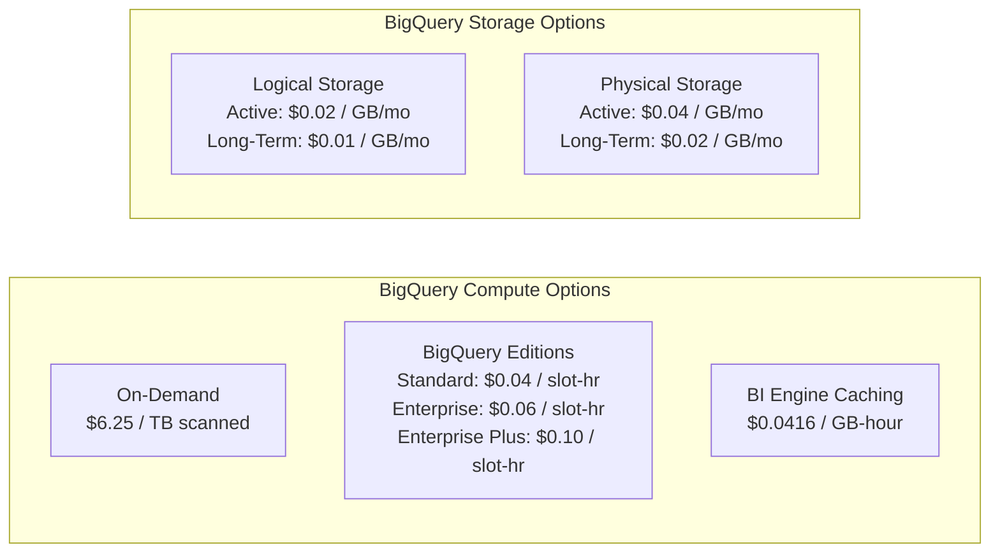
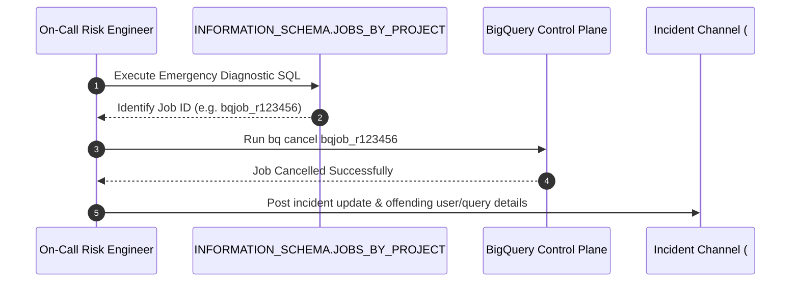

# BigQuery Cost Optimization & FinOps Runbook

## Executive Summary

This runbook establishes production FinOps standards, proactive architectural cost controls, query anti-pattern remediation rules, and an emergency incident response protocol for **Google Cloud BigQuery** in the **Trading Risk Engine** platform.

In an institutional quantitative trading environment processing millions of tick and execution events daily, unoptimized analytical queries can rapidly consume thousands of dollars in cloud spend. By implementing architectural guardrails—such as mandatory partition filtering, hierarchical clustering, materialized views, and automated billing caps—we maintain sub-second risk monitoring while keeping monthly data warehouse costs strictly bounded.

---

## 1. BigQuery Cost Architecture & Pricing Mechanics

Google Cloud BigQuery separates compute from storage, offering distinct pricing models for each component.



### 1.1 Compute Pricing Models

| Pricing Tier | Unit Cost | Best For | Risk Profile |
| :--- | :--- | :--- | :--- |
| **On-Demand** | **$6.25 per TB** ($6.25 / $10^{12}$ bytes) | Unpredictable, low-to-medium ad-hoc query workloads. | High risk of runaway cost if queries lack partition filters or use `SELECT *`. |
| **Editions: Standard** | **$0.040 per slot-hour** | Basic batch transformations and dev/test environments. | Lacks advanced security and multi-region replication. |
| **Editions: Enterprise** | **$0.060 per slot-hour** | Production mission-critical risk analytics, auto-scaling slots, fine-grained access control. | **Recommended for production.** Cost is predictable and bounded by slot reservation quotas. |
| **Editions: Enterprise Plus** | **$0.100 per slot-hour** | Ultra-high compliance, 99.99% SLA, and customer-managed encryption keys. | Higher base cost. |

> [!TIP]
> **Breakeven Rule of Thumb**: If your daily on-demand query scanning exceeds **15 TB/day** ($93.75/day = ~$2,812/month), migrating to a baseline BigQuery Enterprise Edition reservation with auto-scaling slots yields 30-50% net cost savings.

### 1.2 Storage Billing Models: Logical vs. Physical

- **Logical Billing**:
  - Active: **$0.020 per GB / month** ($20.00 / TB / month)
  - Long-Term (tables unedited for 90 days): **$0.010 per GB / month** (50% automated discount)
- **Physical (Compressed) Billing**:
  - Active: **$0.040 per GB / month**
  - Long-Term: **$0.020 per GB / month**

> [!NOTE]
> Financial tick data (`fact_market_ticks`) typically achieves a **5x to 8x compression ratio** in Capacitor columnar storage. When compression exceeds 2:1, switching dataset storage billing from `LOGICAL` to `PHYSICAL` reduces storage costs by 50% or more.

---

## 2. Architecture-Level Cost Controls

### 2.1 Mandatory Partition Filtering (`require_partition_filter = true`)
All high-volume fact tables in `terraform/modules/bigquery/` and `dwh/bigquery/ddl/` explicitly enforce:
```sql
OPTIONS (
    require_partition_filter = TRUE,
    partition_expiration_days = 730
);
```
- Any query submitted without a `WHERE` filter containing the partition column (`tick_date`, `trade_date`, `valuation_date`, `alert_date`) is **rejected by the query compiler before scanning a single byte**.
- Prevents accidental full table scans by analysts or automated dashboards.

### 2.2 Hierarchical Clustering Strategy
Clustering sorts and co-locates rows in 256MB Capacitor storage blocks based on up to 4 columns.
- `fact_trade_orders`: `CLUSTER BY portfolio_id, ticker, trader_id, execution_status`
- `fact_market_ticks`: `CLUSTER BY asset_class, ticker`
- `fact_risk_stats`: `CLUSTER BY portfolio_id, risk_regime, confidence_level`

> [!IMPORTANT]
> Always place columns in order of filter frequency and cardinality. High-frequency filter columns (`portfolio_id`) must precede lower-frequency attributes (`execution_status`).

### 2.3 Automated Partition Expiration
- `fact_market_ticks`: `partition_expiration_days = 730` (2-year sliding window). Older ticks are automatically purged without manual batch deletion jobs.
- `fact_trade_orders`: `partition_expiration_days = 1825` (5-year regulatory compliance retention).

---

## 3. Materialized View FinOps Strategy & ROI

BigQuery Materialized Views precompute aggregations and incrementally maintain them every 15 minutes.

### 3.1 Return on Investment (ROI) Formula
Maintaining an MV incurs maintenance refresh costs, but saves money on frequent dashboard queries:
$$\text{Daily Net Savings} = (Q \times C_{\text{raw}}) - (Q \times C_{\text{mv}} + C_{\text{refresh}}) - \frac{C_{\text{storage}}}{30}$$

Where:
- $Q$ = Queries executed per day
- $C_{\text{raw}}$ = Cost per raw table query ($\approx \$0.005$)
- $C_{\text{mv}}$ = Cost per materialized view query ($\approx \$0.0003$)
- $C_{\text{refresh}}$ = Cost of scheduled 15-minute refresh queries ($\approx \$0.25/\text{day}$)

### 3.2 Breakeven Point
For `mv_realtime_market_performance`:
$$\text{Breakeven Queries} = \frac{C_{\text{refresh}}}{C_{\text{raw}} - C_{\text{mv}}} = \frac{\$0.25}{\$0.0047} \approx 53 \text{ queries/day}$$
When real-time dashboards run more than 53 times daily (or every ~27 minutes), the Materialized View delivers positive net cost savings.

---

## 4. Query Anti-Pattern & Cost Remediation Catalog

### Anti-Pattern 1: `SELECT *` Column Expansion
- **Severity**: `CRITICAL` (Finding ID: `BQ-COST-001`)
- **Impact**: Multiplies bytes scanned by 5x-10x because Capacitor scans every column requested.
- **Bad SQL**:
  ```sql
  -- BAD: Reads all 18 columns including unused JSON payloads
  SELECT * FROM trading_risk_dwh_dev.fact_trade_orders
  WHERE trade_date = '2026-03-01';
  ```
- **Remediated SQL**:
  ```sql
  -- GOOD: Scans only the 4 required columns (75% scan reduction)
  SELECT order_id, ticker, quantity, notional_usd
  FROM trading_risk_dwh_dev.fact_trade_orders
  WHERE trade_date = '2026-03-01';
  ```

---

### Anti-Pattern 2: Non-Sargiable Date Functions on Partition Keys
- **Severity**: `WARNING` (Finding ID: `BQ-COST-007`)
- **Impact**: Wrapping a partition column in a function defeats partition pruning, causing full table scans.
- **Bad SQL**:
  ```sql
  -- BAD: Function prevents partition pruning
  SELECT ticker, AVG(mid_price)
  FROM trading_risk_dwh_dev.fact_market_ticks
  WHERE DATE(event_timestamp) = '2026-03-01'
  GROUP BY ticker;
  ```
- **Remediated SQL**:
  ```sql
  -- GOOD: Direct filter on partition column tick_date
  SELECT ticker, AVG(mid_price)
  FROM trading_risk_dwh_dev.fact_market_ticks
  WHERE tick_date = '2026-03-01'
  GROUP BY ticker;
  ```

---

### Anti-Pattern 3: Cartesian Cross Joins
- **Severity**: `CRITICAL` (Finding ID: `BQ-COST-004`)
- **Impact**: Produces $N \times M$ intermediate row explosions, resulting in slot memory overflow.
- **Bad SQL**:
  ```sql
  -- BAD: Cartesian join across facts and portfolios
  SELECT f.order_id, p.portfolio_name
  FROM trading_risk_dwh_dev.fact_trade_orders f, trading_risk_dwh_dev.dim_portfolios p;
  ```
- **Remediated SQL**:
  ```sql
  -- GOOD: Explicit join on foreign key
  SELECT f.order_id, p.portfolio_name
  FROM trading_risk_dwh_dev.fact_trade_orders f
  INNER JOIN trading_risk_dwh_dev.dim_portfolios p ON f.portfolio_id = p.portfolio_id
  WHERE f.trade_date = '2026-03-01';
  ```

---

### Anti-Pattern 4: Unbounded `ORDER BY`
- **Severity**: `WARNING` (Finding ID: `BQ-COST-005`)
- **Impact**: Forces full distributed dataset to be gathered and sorted on a single worker node.
- **Remediated SQL**: Always supply a `LIMIT` clause (e.g. `ORDER BY notional_usd DESC LIMIT 100`).

---

## 5. Guardrails, Quotas, and Proactive Alerting

### 5.1 Enforcing `maximum_bytes_billed` in Python & Airflow
All programmatic clients must configure `maximum_bytes_billed` on their QueryJobConfig to terminate any query exceeding the defined threshold before it executes:

```python
from google.cloud import bigquery

client = bigquery.Client()
job_config = bigquery.QueryJobConfig(
    maximum_bytes_billed=53_687_091_200,  # 50 GB ceiling (~$0.31 max cost)
    labels={"cost_center": "trading_risk", "environment": "dev"}
)
query_job = client.query("SELECT ...", job_config=job_config)
```

### 5.2 User & Project Quota Ceilings
Configure custom daily query limits per user in the Cloud Console or Terraform:
- **Default Analyst Quota**: 500 GB / day ($3.12 / day)
- **Service Account (Airflow / Dataflow)**: 5 TB / day ($31.25 / day)

### 5.3 Cloud Monitoring Budget Alert Thresholds
Automated notifications are configured across 4 thresholds:
- **50% of budget**: Low-priority Slack notification (`#gcp-alerts-info`).
- **75% of budget**: Medium-priority Slack warning (`#gcp-alerts-warning`).
- **90% of budget**: High-priority alert + automated throttling of ad-hoc query slot reservations.
- **100% of budget**: Critical PagerDuty incident + restriction of non-essential ETL batch jobs.

---

## 6. Emergency Incident Response: Runaway Query Remediation

When a runaway query or slot spike occurs:



### Step 1: Detect & Identify the Offending Job
Execute the emergency diagnostic query against `INFORMATION_SCHEMA`:

```sql
SELECT
    project_id,
    job_id,
    user_email,
    state,
    creation_time,
    start_time,
    TIMESTAMP_DIFF(CURRENT_TIMESTAMP(), start_time, SECOND) AS running_seconds,
    total_bytes_billed,
    ROUND(total_bytes_billed / POWER(1024, 4) * 6.25, 4) AS cost_usd,
    total_slot_ms,
    query
FROM `trading-risk-engine-dev`.`region-us-central1`.INFORMATION_SCHEMA.JOBS_BY_PROJECT
WHERE state = 'RUNNING'
  AND (total_bytes_billed >= 10000000000 OR TIMESTAMP_DIFF(CURRENT_TIMESTAMP(), start_time, SECOND) > 180)
ORDER BY total_bytes_billed DESC
LIMIT 5;
```

### Step 2: Terminate the Runaway Job Immediately
Execute the cancellation command via the `bq` CLI:

```bash
bq --project_id=trading-risk-engine-dev --location=us-central1 cancel <JOB_ID>
```

Alternatively, terminate via the Python client:
```python
client.cancel_job(job_id="<JOB_ID>", location="us-central1")
```

### Step 3: Implement Immediate Session Throttling
If repeated runaway queries originate from a specific user or automated service account, temporarily throttle their session limit:
```sql
ALTER PROJECT `trading-risk-engine-dev`
SET OPTIONS (
    `custom_rules` = [("max_query_bytes", "10000000000")]
);
```

### Step 4: Post-Mortem & Remediation
1. Contact the user or review the DAG/dashboard generating the query.
2. Run `python -m dwh.bigquery.cost_cli --analyze-sql "<OFFENDING_QUERY>"` to extract optimization recommendations.
3. Apply partition filters or convert to a Materialized View before re-enabling.
