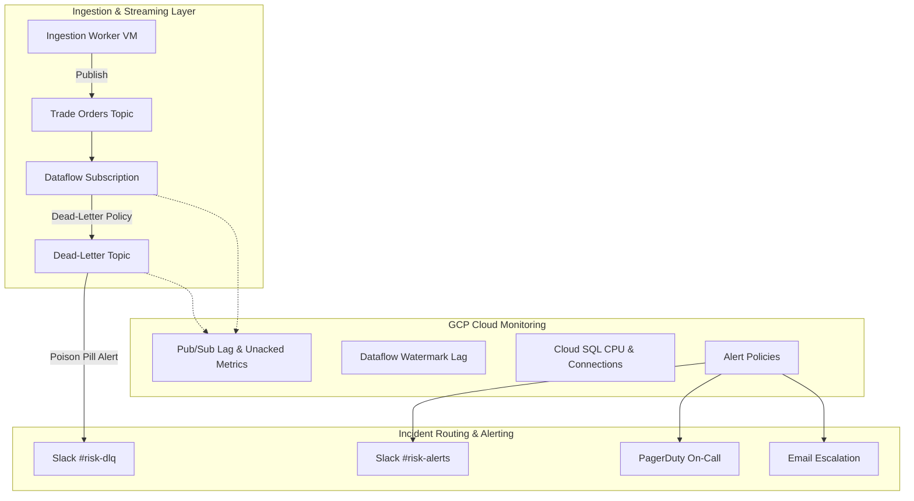

# Cloud Monitoring & Alerting Runbook

## Overview & Architecture

The **Trading Risk Engine** employs Google Cloud Monitoring, Pub/Sub metric analytics, and Slack Block Kit webhooks to maintain real-time observability across all streaming data and risk computation pipelines.



---

## 1. Alert Policy Catalog

| Policy ID | Metric Type | Threshold | Duration | Severity | Notification Channels |
| :--- | :--- | :--- | :--- | :--- | :--- |
| `pubsub_subscription_lag` | `pubsub.googleapis.com/subscription/num_undelivered_messages` | `> 10,000` | 300s | **CRITICAL** | Slack `#risk-alerts`, Email |
| `pubsub_oldest_unacked_age` | `pubsub.googleapis.com/subscription/oldest_unacked_message_age` | `> 300s` | 300s | **CRITICAL** | Slack `#risk-alerts`, Email |
| `pubsub_dlq_message_spike` | `pubsub.googleapis.com/topic/send_request_count` | `> 0` | 60s | **CRITICAL** | Slack `#risk-dlq`, PagerDuty |
| `dataflow_system_lag` | `dataflow.googleapis.com/job/system_lag` | `> 120s` | 300s | **WARNING** | Slack `#risk-alerts`, Email |
| `cloudsql_cpu_high` | `cloudsql.googleapis.com/database/cpu/utilization` | `> 80%` | 600s | **WARNING** | Slack `#risk-alerts`, Email |
| `ingestion_worker_down` | `compute.googleapis.com/instance/uptime` | `< 1` | 180s | **CRITICAL** | Slack `#risk-alerts`, PagerDuty |

---

## 2. Standard Operating Procedures (SOPs)

### 2.1 Pub/Sub Lag Remediation SOP (`#pubsub-lag-remediation`)

#### Symptoms
- Alert triggered: `[CRITICAL] Pub/Sub Trade Orders Subscription Lag`.
- Undelivered message backlog exceeds 10,000 messages or oldest unacknowledged message age exceeds 300 seconds.

#### Diagnostic Steps
1. **Verify Subscription Backlog & Rates**:
   ```bash
   gcloud pubsub subscriptions describe sub-trade-orders-dataflow-prod
   ```
2. **Inspect Dataflow Worker Health & Throughput**:
   ```bash
   gcloud dataflow jobs list --status=active
   gcloud compute instances list --filter="name:dataflow-*"
   ```
3. **Calculate Estimated Drain Time (ETD)**:
   $$\text{ETD} = \frac{\text{Backlog Messages}}{\text{Consumption Rate} - \text{Publish Rate}}$$
   If consumption rate is 0 msgs/sec, consumer is **STALLED**.

#### Remediation Actions
1. If Dataflow workers are saturated (CPU > 85%), scale worker pool:
   ```bash
   # Enable maximum worker autoscaling on Dataflow pipeline
   --maxNumWorkers=20 --autoscalingAlgorithm=THROUGHPUT_BASED
   ```
2. If consumer is stalled due to poison pills, check DLQ status.

---

### 2.2 Dead-Letter Queue Triage SOP (`#dlq-triage-sop`)

#### Symptoms
- Alert triggered: `:rotating_light: [CRITICAL] Trade Order DLQ Poison Pill Received` in `#risk-dlq`.
- Dead-letter topic `top-trade-orders-dlq-*` has received one or more unparseable or rejected messages.

#### Diagnostic Steps
1. **Run DLQ Forensic CLI**:
   ```bash
   python -m monitoring.cli --inspect-dlq
   ```
2. **Inspect Quarantine Storage**:
   ```bash
   gsutil ls gs://trading-risk-bronze-prod/quarantine/
   ```
3. **Analyze Failure Classification**:
   - `JSON_DECODE_ERROR`: Corrupted byte stream, malformed syntax.
   - `SCHEMA_VALIDATION_ERROR`: Missing mandatory fields (`order_id`, `portfolio_id`, `ticker`).
   - `NON_POSITIVE_PRICE_ERROR`: Price $\le 0$ violation.
   - `NON_POSITIVE_QUANTITY_ERROR`: Volume/shares $\le 0$ violation.
   - `CROSSED_QUOTE_ERROR`: Market tick with `bid > ask`.

#### Remediation Actions
1. Contact offending trade feed counterparty or upstream producer.
2. If schema format changed legitimately, update decoders in `streaming/dataflow/decoders.py`.
3. Replay validated dead-letter records into primary topic once producer bug is fixed.

---

### 2.3 Cloud Dataflow System Lag SOP (`#dataflow-lag-remediation`)

#### Symptoms
- Alert triggered: `[WARNING] Cloud Dataflow Streaming System Lag`.
- Watermark lag exceeds 120 seconds.

#### Remediation Actions
1. Check for key hot-spotting (e.g. single ticker receiving 90% volume).
2. Enable streaming engine shuffle service: `--experiments=use_runner_v2`.
3. Verify GCS / Cloud SQL sink latencies.

---

### 2.4 Cloud SQL CPU Remediation SOP (`#cloudsql-cpu-remediation`)

#### Symptoms
- Alert: `[WARNING] Cloud SQL PostgreSQL High CPU Utilization` (> 80%).

#### Remediation Actions
1. Inspect active PostgreSQL queries:
   ```sql
   SELECT pid, age(clock_timestamp(), query_start), usename, query
   FROM pg_stat_activity
   WHERE state != 'idle' AND query NOT ILIKE '%pg_stat_activity%'
   ORDER BY age(clock_timestamp(), query_start) DESC;
   ```
2. Verify indexing on `risk_alerts` table: `alert_id` (PK), `portfolio_id`, `detected_at`.

---

## 3. Local Zero-Cost Testing & Verification

The monitoring and alerting platform operates 100% locally with zero cloud costs using in-memory mocks and local emulators.

### Run Local CLI Validation
```bash
# Validate all Cloud Monitoring alert policies
python -m monitoring.cli --validate-policies

# Calculate Pub/Sub lag and drain times
python -m monitoring.cli --check-lag --backlog-count 15000 --oldest-age-sec 400

# Inspect simulated Dead-Letter Queue records
python -m monitoring.cli --inspect-dlq

# Simulate a critical DLQ poison pill alert
python -m monitoring.cli --simulate-alert

# Export Prometheus exposition metrics
python -m monitoring.cli --export-prometheus
```
