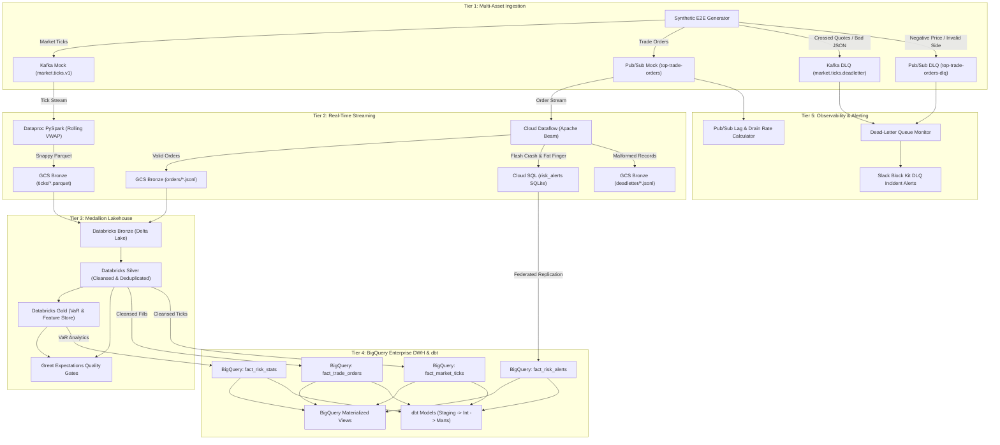

# End-to-End Integration Testing & Data Lineage Runbook

## 1. Executive Summary

The **Trading Risk Engine End-to-End (E2E) Integration Test Runner** provides an autonomous, hermetic, zero-cost verification harness that orchestrates and reconciles data across the entire platform lifecycle: from high-frequency tick and trade order ingestion, through real-time streaming anomaly detection, medallion lakehouse batch curation (Bronze -> Silver -> Gold), data quality validation gates, enterprise data warehouse star schema replication, dbt mart modeling, to observability and operational alerting.

All seven architectural tiers execute 100% locally using zero-cost lightweight substitutes:
- **BigQuery Substitute**: Local in-memory DuckDB emulator (`LocalBigQueryEmulator`) supporting GoogleSQL DDL, star schema tables, partition filter constraints, Materialized Views, and EXTERNAL_QUERY federation.
- **Cloud SQL Substitute**: Local SQLite database (`CloudSqlDatabaseClient`) replicating PostgreSQL operational tables (`risk_alerts`, `portfolio_limits`).
- **Pub/Sub & Kafka Substitutes**: In-memory mocks (`AsyncLocalPubSubMock`, `LocalKafkaProducerMock`) providing multi-partition routing, deterministic ordering keys, and dead-letter queues.
- **GCS & Delta Lake Substitutes**: Local file system paths organizing Hive-partitioned Snappy Parquet files and ACID transactional Delta tables.

---

## 2. End-to-End Architecture & Data Flow



---

## 3. Seven Architectural Execution Stages

| Stage Number | Stage Identifier | Core Operational Responsibility | Primary Input | Primary Output |
| :---: | :--- | :--- | :--- | :--- |
| **Stage 1** | `ingestion` | Publishes multi-asset synthetic streams to brokers | `SyntheticE2EGenerator` | Kafka & Pub/Sub topics |
| **Stage 2** | `streaming` | Decodes orders, detects microstructural anomalies, writes sinks | Kafka/PubSub mock streams | Cloud SQL SQLite, GCS Bronze |
| **Stage 3** | `lakehouse_batch` | Cleanses, deduplicates, and computes portfolio VaR | GCS Bronze files | Delta Lake Bronze, Silver, Gold |
| **Stage 4** | `data_quality` | Evaluates Great Expectations checkpoint suites | Silver & Gold Delta datasets | Validation reports & pass gates |
| **Stage 5** | `dwh_replication` | Replicates Cloud SQL, merges facts, initializes MVs | Silver, Gold, Cloud SQL | BigQuery Star Schema DuckDB |
| **Stage 6** | `dbt_analytics` | Executes 15 dbt models in topological order, tests constraints | BigQuery Star Schema facts | dbt staging, intermediate, marts |
| **Stage 7** | `monitoring_observability` | Calculates lag/ETD, classifies poison pills, builds Slack cards | Pub/Sub & Kafka DLQ streams | Forensic reports & Slack Block Kit |

---

## 4. Mathematical Lineage & Reconciliation Invariants

The validator evaluates strict mathematical invariants across architectural boundaries:

### 4.1 Record Count Conservation
$$\begin{aligned}
N_{\text{orders, injected}} &= N_{\text{orders, valid}} + N_{\text{orders, dlq}} \\
N_{\text{orders, valid}} &= N_{\text{orders, silver}} = N_{\text{orders, bq\_fact}} = N_{\text{orders, dbt\_stg}} \\
N_{\text{ticks, injected}} &= N_{\text{ticks, valid}} + N_{\text{ticks, dlq}} \\
N_{\text{ticks, valid}} &= N_{\text{ticks, silver}} = N_{\text{ticks, bq\_fact}} = N_{\text{ticks, dbt\_stg}}
\end{aligned}$$

### 4.2 Gross Notional USD Reconciliation
The gross notional value of all filled orders is conserved exactly across ingestion, medallion cleansing, warehouse loading, and dbt analytical marts:
$$\left| \sum \text{notional}_{\text{ingested}} - \sum \text{notional}_{\text{bigquery, fact}} \right| \le \epsilon \quad (\epsilon = \$0.05)$$
$$\left| \sum \text{notional}_{\text{ingested}} - \sum \text{notional}_{\text{dbt, stg}} \right| \le \epsilon$$

### 4.3 Anomaly Detection Conservation
All injected price drops exceeding the 5.0% 5-minute threshold and single-order notionals exceeding $5,000,000 are captured:
$$A_{\text{flash\_crash, detected}} \ge A_{\text{flash\_crash, injected}}$$
$$A_{\text{fat\_finger, detected}} \ge A_{\text{fat\_finger, injected}}$$
$$\text{Alerts}_{\text{CloudSQL}} = \text{Alerts}_{\text{fact\_risk\_alerts}} = \text{Alerts}_{\text{fct\_risk\_alerts\_summary}}$$

### 4.4 Value-at-Risk Parity
Portfolio VaR metrics computed in Databricks Gold Delta match rows in BigQuery `fact_risk_stats` and dbt `fct_portfolio_risk_daily`:
$$N_{\text{gold\_portfolio\_var}} = N_{\text{fact\_risk\_stats}} = N_{\text{fct\_portfolio\_risk\_daily}}$$

---

## 5. Pre-Configured Execution Scenarios

1. **`happy_path`**:
   - Clean financial orders and ticks across Equities, ETFs, FX, Crypto, and Commodities.
   - Zero corrupted records injected; verifies clean-stream end-to-end processing.
2. **`anomaly_injection`**:
   - Injects a 7.5% flash crash price drawdown on `AAPL` (5 falling orders from $200 down to $185).
   - Injects a $6.25M single-order fat finger breach on `NVDA` ($500.00 $\times$ 12,500 shares).
   - Verifies real-time detection, Cloud SQL storage, BigQuery replication, and dbt alert rollup.
3. **`corrupted_dlq`**:
   - Injects negative prices, negative volumes, invalid transaction sides, and malformed JSON.
   - Injects crossed quotes (`ask_price < bid_price`).
   - Verifies 100% quarantine into dead-letter queues with forensic classification and zero data leakage.
4. **`full_e2e`**:
   - Combined institutional stress test: clean order flow + flash crash + fat finger + DLQ poison pills.
   - Evaluates all 7 stages and 12+ lineage reconciliation assertions simultaneously.

---

## 6. Command-Line Interface (CLI) Usage

The runner is invoked via standard Python CLI:

```bash
# Execute full end-to-end integration test
python -m e2e.cli --scenario full_e2e --scale-factor 1.0 --target-date 2026-11-09

# Run dry-run execution plan
python -m e2e.cli --dry-run --scenario full_e2e

# Execute specific stages only (e.g., Ingestion, Streaming, Lakehouse)
python -m e2e.cli --stages ingestion,streaming,lakehouse_batch --scale-factor 0.5

# Export full reports (Markdown, JSON, and Prometheus)
python -m e2e.cli \
  --scenario full_e2e \
  --json-report reports/e2e_summary.json \
  --markdown-report reports/e2e_summary.md \
  --export-prometheus reports/e2e_metrics.prom
```

---

## 7. Operational Telemetry & OpenMetrics

The runner exposes real-time Prometheus / OpenMetrics compliant metrics:
- `e2e_pipeline_runs_total{scenario="...",status="..."}`
- `e2e_stage_duration_seconds{stage="..."}`
- `e2e_records_processed_total{stage="...",direction="..."}`
- `e2e_validation_assertions_total{category="...",outcome="..."}`
- `e2e_sla_violations_total`
