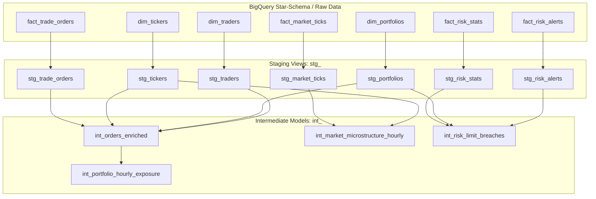

# trading_risk_dbt: BigQuery & DuckDB dbt Project (Day 23)

## Architecture Overview
`trading_risk_dbt` is an enterprise financial analytics dbt project transforming raw BigQuery star-schema tables into standardized staging models and multi-dimensional intermediate analytical datasets.

## Models Catalog

### Staging Layer (`models/staging/`)
- `stg_trade_orders`: Extracts trade order fills, generates deterministic MD5 surrogate key `trade_order_key`, computes exact notional USD, and cleans flags (`is_filled`, `is_buy`, `is_sell`).
- `stg_market_ticks`: Extracts tick prints, computes absolute spread, mid price, relative spread in basis points (`relative_spread_bps`), and surrogate key `market_tick_key`.
- `stg_risk_stats`: Standardizes portfolio VaR (parametric, historical, Monte Carlo) and CVaR / Expected Shortfall, calculates risk headroom and tail risk ratio.
- `stg_risk_alerts`: Extracts operational anomalies and limit breaches with critical severity classification.
- `stg_tickers`, `stg_portfolios`, `stg_traders`: Dimensional staging views standardizing business keys, desks, and risk mandates.

### Intermediate Layer (`models/intermediate/`)
- `int_orders_enriched`: Denormalizes orders with ticker metadata, trader limits, signed notional USD, notional tier classification (`MICRO`, `STANDARD`, `LARGE`, `BLOCK`), aggressive taker flag (`is_aggressive`), single-order limit breach detection, and trader intra-day order sequencing.
- `int_portfolio_hourly_exposure`: Rolls up orders hourly per portfolio and desk, deriving gross turnover, net directional exposure, order flow imbalance, and aggressive trade ratios.
- `int_market_microstructure_hourly`: Rolls up high-frequency ticks hourly per instrument, computing OHLC prices, exact hourly VWAP, total contract volume, and volatility price range in basis points.
- `int_risk_limit_breaches`: Evaluates portfolio risk headroom, tail risk ratios, limit breach severity (`NORMAL`, `WARNING`, `CRITICAL`), and correlated operational alerts.
