# trading_risk_dbt: BigQuery & DuckDB dbt Project (Days 23-24)

## Architecture Overview
`trading_risk_dbt` is an enterprise financial analytics dbt project transforming raw BigQuery star-schema tables into standardized staging models, multi-dimensional intermediate analytical datasets, and high-performance analytical mart tables, coupled with BigQuery Materialized Views for sub-second real-time market performance analytics.

```mermaid
flowchart TD
    subgraph Sources [BigQuery Star-Schema / Raw Data]
        S_ORDERS[fact_trade_orders]
        S_TICKS[fact_market_ticks]
        S_STATS[fact_risk_stats]
        S_ALERTS[fact_risk_alerts]
        S_TICKERS[dim_tickers]
        S_PORTS[dim_portfolios]
        S_TRADERS[dim_traders]
    end

    subgraph MaterializedViews [BigQuery Materialized Views: mv_]
        MV_TICKS[mv_realtime_market_performance]
        MV_ORDERS[mv_realtime_trader_exposure]
        MV_ALERTS[mv_realtime_risk_alerts]
    end

    subgraph Staging [Staging Views: stg_]
        STG_ORDERS[stg_trade_orders]
        STG_TICKS[stg_market_ticks]
        STG_STATS[stg_risk_stats]
        STG_ALERTS[stg_risk_alerts]
        STG_TICKERS[stg_tickers]
        STG_PORTS[stg_portfolios]
        STG_TRADERS[stg_traders]
    end

    subgraph Intermediate [Intermediate Models: int_]
        INT_ENRICHED[int_orders_enriched]
        INT_HOURLY[int_portfolio_hourly_exposure]
        INT_MICRO[int_market_microstructure_hourly]
        INT_BREACHES[int_risk_limit_breaches]
    end

    subgraph Marts [Analytical Mart Tables: fct_]
        MART_MKT[fct_daily_market_performance]
        MART_TRADER[fct_trader_performance_daily]
        MART_RISK[fct_portfolio_risk_daily]
        MART_ALERTS[fct_risk_alerts_summary]
    end

    S_TICKS -.-> MV_TICKS
    S_ORDERS -.-> MV_ORDERS
    S_ALERTS -.-> MV_ALERTS

    S_ORDERS --> STG_ORDERS
    S_TICKS --> STG_TICKS
    S_STATS --> STG_STATS
    S_ALERTS --> STG_ALERTS
    S_TICKERS --> STG_TICKERS
    S_PORTS --> STG_PORTS
    S_TRADERS --> STG_TRADERS

    STG_ORDERS --> INT_ENRICHED
    STG_TICKERS --> INT_ENRICHED
    STG_PORTS --> INT_ENRICHED
    STG_TRADERS --> INT_ENRICHED

    INT_ENRICHED --> INT_HOURLY

    STG_TICKS --> INT_MICRO
    STG_TICKERS --> INT_MICRO

    STG_STATS --> INT_BREACHES
    STG_PORTS --> INT_BREACHES
    STG_ALERTS --> INT_BREACHES

    INT_MICRO --> MART_MKT
    STG_TICKERS --> MART_MKT

    INT_ENRICHED --> MART_TRADER
    STG_TRADERS --> MART_TRADER
    STG_PORTS --> MART_TRADER

    INT_BREACHES --> MART_RISK
    STG_PORTS --> MART_RISK

    STG_ALERTS --> MART_ALERTS
    STG_PORTS --> MART_ALERTS
```

## Models Catalog

### Staging Layer (`models/staging/`)
- `stg_trade_orders`: Extracts trade order fills, generates deterministic MD5 surrogate key `trade_order_key`, computes exact notional USD, and cleans flags (`is_filled`, `is_buy`, `is_sell`).
- `stg_market_ticks`: Extracts tick prints, computes absolute spread, mid price, relative spread in basis points (`relative_spread_bps`), and surrogate key `market_tick_key`.
- `stg_risk_stats`: Standardizes portfolio VaR (parametric, historical, Monte Carlo) and CVaR / Expected Shortfall, calculates risk headroom and tail risk ratio.
- `stg_risk_alerts`: Extracts operational anomalies and limit breaches with critical severity classification.
- `stg_tickers`, `stg_portfolios`, `stg_traders`: Dimensional staging views standardizing business keys, desks, and risk mandates.

### Intermediate Layer (`models/intermediate/`)
- `int_orders_enriched`: Denormalizes orders with ticker metadata, trader limits, signed notional USD, notional tier classification (`MICRO`, `STANDARD`, `LARGE`, `BLOCK`), aggressive taker flag (`is_aggressive`), single-order limit breach detection, and trader intra-day order sequencing.
- `int_portfolio_hourly_exposure`: Rolls up orders hourly per portfolio and desk, deriving gross turnover, net directional exposure, order flow imbalance, and aggressive trade ratios.
- `int_market_microstructure_hourly`: Rolls up high-frequency ticks hourly per instrument, computing OHLC prices, exact hourly VWAP, total contract volume, and volatility price range in basis points.
- `int_risk_limit_breaches`: Evaluates portfolio risk headroom, tail risk ratios, limit breach severity (`NORMAL`, `WARNING`, `CRITICAL`), and correlated operational alerts.

### Marts Layer (`models/marts/` - Day 24)
- `fct_daily_market_performance`: Daily instrument market performance mart capturing OHLC prices, session VWAP, spread metrics, and liquidity classification (`HIGH`, `MEDIUM`, `LOW`).
- `fct_trader_performance_daily`: Daily trader, desk, and execution quality performance mart analyzing order counts, gross turnover, net delta, aggressive taker ratio, block trades, and single-order limit compliance.
- `fct_portfolio_risk_daily`: Daily portfolio risk, capital adequacy, and limit compliance mart joining VaR methodologies (parametric, historical, Monte Carlo), CVaR Expected Shortfall, headroom, utilization %, and capital adequacy.
- `fct_risk_alerts_summary`: Analytical summary mart of streaming anomaly alerts, flash crashes, fat finger events, and limit breaches by desk, portfolio, and severity.

### BigQuery Materialized Views (`dwh/bigquery/ddl/` - Day 24)
- `mv_realtime_market_performance`: Automated 15-minute refresh materialized view aggregating real-time tick volume, gross notional USD, relative spread in bps, and bid/ask boundaries over `fact_market_ticks`.
- `mv_realtime_trader_exposure`: Automated 15-minute refresh materialized view aggregating real-time executed order count, gross notional, fees, and slippage over `fact_trade_orders`.
- `mv_realtime_risk_alerts`: Automated 15-minute refresh materialized view aggregating streaming risk alerts and anomaly breach metrics over `fact_risk_alerts`.
